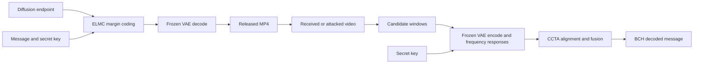

# LAST

Training-free, inversion-free video watermarking with endpoint latent-frequency margin coding (ELMC) and cross-group consistency temporal alignment (CCTA).

## Reproduction status

This repository is being constructed from a frozen manuscript protocol. Full-paper experiments have **not** been reproduced yet. Historical pilot results are not full-benchmark results, and manuscript values are not used as measured outputs.

The reproduction targets 512 information bits, two video backbones (HunyuanVideo and Wan-2.2 A14B), both T2V and I2V, matched baselines, spatial/temporal attacks, quality evaluation and ablations. Runs record model revisions, software versions, seed schedules, codec settings, raw counts, failures and hardware differences.

Generation is being verified on an NVIDIA L40; the manuscript specifies A800 generation. This hardware difference is recorded. Timing runs use an idle L40.

Secret keys, private messages, credentials and model weights are not committed.

## Method overview

LAST writes a BCH-coded message into selected middle-frequency coefficients of
the final diffusion latent. ELMC changes only coefficients that do not meet the
required signed margin along keyed orthogonal directions. Each temporal group
has its own codebook. The frozen VAE decodes the latent into the released video.

At extraction, candidate short windows are encoded directly by the frozen VAE.
CCTA combines keyed responses with temporal and cross-group message consistency,
then fuses evidence for BCH decoding. It does not run diffusion inversion or
require the original message, prompt, seed or unmarked video. This describes
the implemented mechanism, not a guarantee of recovery under every edit.



## Measured results

For main Tables 1 and 2, the [reporting guide](docs/REPORTING.md) gives the
clean and attacked table commands. The [paired temporal results](docs/REPORTING.md#matched-temporal-attacks-by-backbone-and-input-mode)
use matched LAST and LFG videos. The table below links the observations and
gives the sample count for each pipeline.
For the component ablation, run the following command from the repository
root to compare writer and reader variants on the same 12 of 30 planned
videos. It prints all seven conditions and the two writer fidelity scores.

```bash
python tools/matched_component_table.py --archived-reread results/hunyuan_i2v_archived_reader_pair.json
```

**Primary random frame deletion remains a substantial reproduction discrepancy.**
The manuscript reports 96.0% bit accuracy and 368/400 exact messages for HunyuanVideo image-to-video after deleting 30 of 65 frames. The L40 rerun recovered **66,486/91,648 bits (72.54%) and 1/179 exact messages** across the first 179 videos. For 171 videos the original receipts identify the received MP4. The other eight use independent extractions from the archived videos because their original receipts lack that fingerprint. The two sets of video IDs are disjoint. Recount both contributions on CPU:

```bash
python tools/hunyuan_prefix_recovery.py --additional-original results/hunyuan_i2v_message_178_179.json \
  --verify-original-slice results/hunyuan_i2v_last_primary100_178.json
```

For deletion, the command reports 63,532/87,552 bits from original receipts and 2,954/4,096 bits from re-extraction. On the same 179 attacked videos, supplying the true frame map to the diagnostic reader yielded 90,564/91,648 correct bits (98.82%) and 104/179 complete messages. The assisted reader also fills missing slots and fuses surviving groups, so this comparison measures their combined effect. Even with this assistance, 75 messages still contained errors. Recount both readers on all seven conditions:

```bash
python tools/paired_oracle_table.py --report results/hunyuan_i2v_last_first100_robustness.json \
  --report results/hunyuan_i2v_last_primary100_178.json --manifest configs/primary_manifest.json \
  --oracle-dir results --count 179
```

The cause of the full discrepancy remains open. To inspect the [170 original deletion records](results/hunyuan_i2v_primary_deletion_errors.json) separately:

```bash
python tools/primary_deletion_errors.py --report results/hunyuan_i2v_primary_deletion_errors.json
```

The [statistical protocol](docs/STATISTICS.md) also explains how to repeat the checks against the generated MP4 files. For supplementary margin sensitivity, the three-video Figure 4 measurements and replay commands are in the [ablation guide](docs/ABLATIONS.md). The 80-video sensitivity study and full quality scores are pending.

The following paired subsets use the frozen primary manifest and 512 information bits per video. Each method has seven observations per video, covering clean extraction and six attacks. The paper protocol calls for 400 videos per generation pipeline. The counts below describe the paired records available in this release.

| Generation pipeline | Paired videos | Bit counts by attack | Paired PSNR and SSIM |
|---|---:|---|---|
| HunyuanVideo, image-to-video | 17 | [17 pairs](results/hunyuan_i2v_primary17.json) | [17 pairs](results/hunyuan_i2v_fidelity17.json) |
| HunyuanVideo, text-to-video | 12 | [12 pairs](results/hunyuan_t2v_primary12.json) | [12 pairs](results/hunyuan_t2v_fidelity12.json) |
| Wan-2.2, image-to-video | 11 | [11 pairs](results/wan22_i2v_primary11.json) | [11 pairs](results/wan22_i2v_fidelity11.json) |
| Wan-2.2, text-to-video | 11 | [11 pairs](results/wan22_t2v_primary11.json) | [11 pairs](results/wan22_t2v_fidelity11.json) |

To compute bit accuracy and the number of fully recovered messages from these records, run the command below for HunyuanVideo image-to-video. For any other row, supply its single bit-count file after `--report`. Each fidelity score uses the unmarked reference generated for that method. The [reporting notes](docs/REPORTING.md) document reference-file differences and sample coverage.

```bash
python tools/paired_lfg_table.py --report results/hunyuan_i2v_primary17.json
```

Earlier evidence includes the [four LAST integration checks](results/last_backbone_integrations.json), the [LFG adaptation check](results/lfg_integration.json), and the first formal cases for [LFG Hunyuan I2V](results/lfg_primary_first_case.json), [LAST Hunyuan T2V](results/last_t2v_primary_first_case.json), and [LAST Wan I2V](results/last_wan_i2v_primary_first_case.json).

## Install (Linux, Python3.10, CUDA-capable NVIDIA GPU)

```bash
git clone https://github.com/twzydn20000928/LAST.git
cd LAST
python3.10 -m venv .venv
source .venv/bin/activate
unset PYTHONPATH
export PYTHONNOUSERSITE=1
python -m pip install -r environments/video-linux-py310-cu124.txt
python -m pip install --no-deps -e .
python -m pip check
python -m last.doctor --strict --require-paper-runtime --output .venv/environment.json
python -m pytest -q
```

The numerical core implements masked1776-coordinate orthonormal DCT-II carriers, deterministic keyed QR, minimum signed margins, truth-free CCTA, an energy-spacing fallback and shortened BCH. It is distinct from earlier pilot implementations. See [the reproduction contract](docs/REPRODUCTION.md) and [frozen settings](configs/paper_v1.json).

## Fresh end-to-end smoke check

For the observed Linux/Python 3.10/CUDA 12.4 dependency versions, see
[environment reconstruction](environments/README.md). This includes transitive
dependencies and excludes server-specific overlay paths.

First follow [data preparation](docs/DATA.md) for the frozen400sample manifest
and verified conditioning images. See [release acceptance](docs/RELEASE_CHECKLIST.md)
for the complete paper-code deliverable and outstanding work.

Download a pinned checkpoint from `configs/models.json`. Supply a JSON case containing `prompt`, `seed` and, for I2V, a local `image` path. Keep output outside version control:

```bash
python -m last.models --name hunyuan_i2v --directory /path/to/checkpoint --download
python -m last.models --name hunyuan_i2v --directory /path/to/checkpoint \
  --verify-manifest configs/checkpoint_files.json
python -m last.models --name hunyuan_i2v --directory /path/to/checkpoint \
  --hash-output /private/model-hashes.json
python -m last.doctor --strict --output /private/environment.json
```

The offline verification command compares cached model files with the Git blob
and LFS digests from the pinned Hugging Face revision. Model cards, figures and
example assets are optional. The manifest covers all four model entries. Provider access
and model/data licenses remain applicable. Full checkpoint hashing can take time.

```bash
python -m last.smoke --family hunyuan --mode i2v \
  --model-dir /path/to/checkpoint --case /path/to/case.json \
  --output /private/runs/smoke-hunyuan-i2v --memory-gib 12 --offload sequential
```

For the validated formal Wan I2V execution, use `--family wan22 --mode i2v --memory-gib 8 --offload sequential` with the matching Wan checkpoint. The
earlier integration also supported model offload with a 42 GiB allocation;
record the chosen offload mode and memory limit with each run. The smoke run
generates a fresh secret/message, generates an unmarked endpoint, embeds LAST,
exports CRF18 MP4, rereads it and blindly extracts 512 information bits. It saves
an honest receipt and private key material. **A smoke run is not a 400-video
benchmark.** The generated keys/messages/predictions and videos must not be
committed.

Evaluate the seven primary attack conditions on that exported video:

```bash
python -m last.evaluate --family hunyuan --model-dir /path/to/checkpoint \
  --run /private/runs/smoke-hunyuan-i2v --video-id integration-case-0
```

Use the same `--video-id` across methods to share attack maps. Each condition
records a separate receipt; failed conditions remain failures, not zero accuracy.
See [implementation choices and reuse policy](docs/REUSE_AUDIT.md).

## Blind extraction of a received video

```bash
python -m last.extract --family hunyuan --model-dir /path/to/checkpoint \
  --video /path/to/received.mp4 --key /private/secret.key \
  --output /private/received.decoded.json
```

The reader rebuilds its codebook from a 32-byte key and encodes the received
512 × 512 RGB video with the frozen VAE. The private output's `message_hex`
field contains 64 decoded bytes (512 information bits, most significant bit
first). The command also records the frame count, alignment route and BCH
decoding status. Assessing accuracy requires a separate comparison to the
original message after extraction.

The [standalone integration check](results/blind_cli_integration.json) used
one Hunyuan I2V video. The clean 65-frame input recovered 512/512 true bits.
After deleting 30 frames, the 35-frame input recovered 371/512. On both
inputs a separately executed extraction returned the same 512 predicted bits,
including the same 141 incorrect bits on the deletion case. To check agreement
between two private outputs on your own MP4 without printing either message:

```bash
python tools/compare_blind_predictions.py --video received.mp4 --first first.decoded.json --second second.decoded.json
```

## Receipts, tables and paired fidelity

For the planned400sample LAST/LFG comparison, see [campaign commands](docs/CAMPAIGN.md).
The worker verifies the frozen source and sample manifest, supports disjoint shards
and resumes complete jobs. Other baselines and supplemental experiments remain
separate release requirements; a successful subset is not full-paper completion.

```bash
python -m last.report --plan configs/integration_plan.json \
  --root /private/runs/paper_reproduction_v1 --output /path/to/report
python -m last.quality --reference /private/run/reference.mp4 \
  --marked /private/run/marked.mp4 --output /private/run/quality.json
```

Reporting writes JSON, CSV and Markdown from an explicit list of planned runs.
Missing/failed observations stay visible; incomplete cells have no final score.
The bundled plan covers integration checks only, not the400sample benchmark.
Paired fidelity reports global RGB-MSE PSNR and11×11 Gaussian SSIM with the
precise metric definition and input hashes. Neither metric is official V-score
or proof of acceptable motion quality. No metric is filled using manuscript targets.

## Implementation and result status

Use the following entry points for the corresponding paper experiments. An
available command is not evidence that the full prescribed sample set has run.

| Experiment or prerequisite | Reader entry point | Current scope |
| --- | --- | --- |
| Primary and disjoint development data | [Data preparation](docs/DATA.md) | All 20 development conditioning images match decoded source frame zero and cover the 80 prescribed sample assignments. |
| Primary LAST/LFG generation and seven attacks | [Campaign](docs/CAMPAIGN.md), `last.smoke`, `last.evaluate` | Paired primary prefixes for both modes of both backbones; measured coverage appears above |
| SIGMark, VideoShield, VideoMark and LFG | [Baselines](docs/BASELINES.md) | Native interfaces and Hunyuan integrations; full baseline matrix pending |
| Paired PSNR/SSIM and official V-score | [Quality](docs/QUALITY.md), `last.quality`, `last.quality_report` | Hunyuan I2V LAST/reference have five of 18 dimensions, including both Creativity dimensions; overall V-score pending |
| Minimum-margin, CGC, sliding-window and CCTA ablations | [Ablations](docs/ABLATIONS.md), `last.reader_ablation`, `tools/writer_ablation_table.py` | 12 of 30 paired equal-margin writer cases; [12 paired reader cases](results/hunyuan_i2v_reader_ablation_first12.json) cover all seven conditions |
| Margin sweep and uniform-profile control | [Figure 4 and Supplement Table 5](docs/ABLATIONS.md#completed-development-margin-sweep), `last.writer_replay --uniform-profile` | Development sweep complete on three videos at five margins; the temporal profile comparison has separate test coverage |
| Matched-writer LFG-C, native LFG+CCTA and oracle grouping | [Paired reader command](docs/BASELINES.md#replay-the-seven-condition-reader-comparison), [oracle diagnostic](docs/ABLATIONS.md) | [17 Hunyuan I2V videos](results/hunyuan_i2v_lfg_ccta_first17.json) with seven paired reader comparisons each. Matched-fidelity calibration pending. |
| Additional temporal stress and repeated attack maps | [Table 15 counts and alignment](docs/STRESS.md#recount-the-eight-edits-on-primary-videos) | 18 Hunyuan I2V videos with eight edits and five map seeds each. Every edit covers 90 of 2,000 planned trials. |
| Bit errors, whole-message recovery and uncertainty | [Statistics](docs/STATISTICS.md), `last.message_outcomes`, `last.cluster_intervals` | Implemented; final summaries require complete planned observations |
| Exclusive-GPU main and repeated timing | [Timing](docs/TIMING.md), `last.reader_timing`, `last.embedding_timing`, `last.timing_summary` | LAST/LFG readout and ELMC kernel entry points available; formal measurements, native-baseline timing and paired generation overhead pending |
| Fresh environment and independent re-extraction | [Environment reconstruction](environments/README.md), [audit protocol](docs/STATISTICS.md), `last.reextract` | Separate seven-condition re-extraction checked; the reader's end-to-end clean-checkout verification is scheduled after repository construction |

Diagnostic JSON files under [results](results/) retain their sample scope and
provenance. They must not be pasted into full-benchmark table cells. The detailed
[release checklist](docs/RELEASE_CHECKLIST.md) remains the completion gate.

Additional experiment entry points are documented for [ablations](docs/ABLATIONS.md),
[temporal stress and repeated maps](docs/STRESS.md), and
[prompt-cluster uncertainty](docs/STATISTICS.md). Their availability is separate
from completion of the full experimental matrix.

Core tests are available. Fresh GPU integration checks are in progress. Dataset manifests, baseline adapters, complete attack runners, confidence intervals, supplemental controls and full-benchmark result bundles are release gates. No fabricated table or historical pilot value is shipped as a new measurement. Do not interpret this repository as a completed or independently validated reproduction.

## Citation and version identification

[CITATION.cff](CITATION.cff) describes the software repository under its existing
LAST contributors attribution. It is not a substitute for the manuscript author
list or a claim of conference acceptance. An archival paper identifier and named
paper authors are not supplied by the anonymous review manuscript, so none are
invented here. Cite the exact Git commit used, together with the frozen protocol
and environment files. For example:

```bibtex
@software{last_software,
  author = {{LAST contributors}},
  title = {{LAST}: Training-Free and Inversion-Free Watermarking for Video Diffusion with Cross-Group Temporal Alignment},
  url = {https://github.com/twzydn20000928/LAST},
  note = {Software under active reproduction; specify the exact commit used}
}
```

A successful integration test or CI run does not establish complete reproduction
of the manuscript tables; consult the release checklist and measured receipts.
