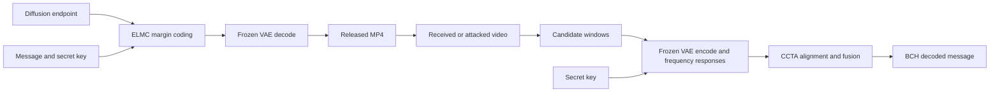

# LAST

Training-free, inversion-free video watermarking with endpoint latent-frequency margin coding (ELMC) and cross-group consistency temporal alignment (CCTA).

## Reproduction status

This repository is being constructed from a frozen manuscript protocol. Full-paper experiments have **not** been reproduced yet. Historical pilot results are not full-benchmark results, and manuscript values are not used as measured outputs.

The reproduction targets 512 information bits, two video backbones (HunyuanVideo and Wan-2.2 A14B), both T2V and I2V, matched baselines, spatial/temporal attacks, quality evaluation and ablations. Runs record model revisions, software versions, seed schedules, codec settings, raw counts, failures and hardware differences.

Generation is being verified on an NVIDIA L40; the manuscript specifies A800 generation. This hardware difference is recorded. Timing runs use an idle L40.

Secret keys, private messages, credentials and model weights are not committed.

## Method overview

LAST writes a BCH-coded message into selected middle-frequency coefficients of
the final diffusion latent. ELMC changes only coefficients that do not meet the
required signed margin along keyed orthogonal directions. Each temporal group
has its own codebook. The frozen VAE decodes the latent into the released video.

At extraction, candidate short windows are encoded directly by the frozen VAE.
CCTA combines keyed responses with temporal and cross-group message consistency,
then fuses evidence for BCH decoding. It does not run diffusion inversion or
require the original message, prompt, seed or unmarked video. This describes
the implemented mechanism, not a guarantee of recovery under every edit.



Actual diagnostic results: [LAST across four backbone/mode pipelines](results/last_backbone_integrations.json)
and [LFG adaptation integration](results/lfg_integration.json). Each is explicitly
a single-case integration check, with raw bit counts and receipt hashes, not a
completed paper benchmark. Temporal attacks still cause substantial errors.

The [first formal LFG adaptation case](results/lfg_primary_first_case.json)
has also completed all seven conditions with source and received-video hashes
verified. This is paper-000 (1 of 400 Hunyuan I2V cases), distinct from the
earlier integration case. Correct information bits are 500/512 clean,
483/512 noise, 488/512 compression, 488/512 blur, 349/512 deletion,
276/512 insertion and 358/512 clipping. Paired PSNR is 22.40 dB and SSIM
0.7813. These single-case measurements do not establish a method ranking or
reproduce the LFG authors' reported results; full comparisons remain pending.

Additional formal single-case records are available for LAST:

| Pipeline | Clean | Noise | Compression | Blur | Delete | Insert | Clip | Paired PSNR / SSIM |
|---|---:|---:|---:|---:|---:|---:|---:|---|
| [Hunyuan T2V](results/last_t2v_primary_first_case.json) | 512 | 512 | 512 | 512 | 447 | 445 | 500 | 28.4489 dB / 0.90084 |
| [Wan2.2 I2V](results/last_wan_i2v_primary_first_case.json) | 512 | 512 | 493 | 512 | 255 | 377 | 487 | 27.7252 dB / 0.92491 |

Entries are correct information bits out of 512 for one frozen sample per
pipeline, not means over 400 videos. These different generation pipelines do
not form a paired backbone ranking. The Wan deletion result is near chance;
it is retained as measured. Full V-score and full-paper acceptance remain open.

## Install (Linux, Python3.10, CUDA-capable NVIDIA GPU)

```bash
git clone https://github.com/twzydn20000928/LAST.git
cd LAST
python -m venv .venv
source .venv/bin/activate
pip install -e '.[video,test]'
pytest -q
```

The numerical core implements masked1776-coordinate orthonormal DCT-II carriers, deterministic keyed QR, minimum signed margins, truth-free CCTA, an energy-spacing fallback and shortened BCH. It is distinct from earlier pilot implementations. See [the reproduction contract](docs/REPRODUCTION.md) and [frozen settings](configs/paper_v1.json).

## Fresh end-to-end smoke check

For the observed Linux/Python 3.10/CUDA 12.4 dependency versions, see
[environment reconstruction](environments/README.md). This includes transitive
dependencies and excludes server-specific overlay paths.

First follow [data preparation](docs/DATA.md) for the frozen400sample manifest
and verified conditioning images. See [release acceptance](docs/RELEASE_CHECKLIST.md)
for the complete paper-code deliverable and outstanding work.

Download a pinned checkpoint from `configs/models.json`. Supply a JSON case containing `prompt`, `seed` and, for I2V, a local `image` path. Keep output outside version control:

```bash
python -m last.models --name hunyuan_i2v --directory /path/to/checkpoint --download
python -m last.models --name hunyuan_i2v --directory /path/to/checkpoint \
  --hash-output /private/model-hashes.json
python -m last.doctor --strict --output /private/environment.json
```

The model command uses the full pinned upstream revision. Existing cached weights
may be reused after verification; hashing records bytes but cannot alone prove
an arbitrary local directory is the correct upstream revision. Provider access
and model/data licenses remain applicable. Full checkpoint hashing can take time.

```bash
python -m last.smoke --family hunyuan --mode i2v \
  --model-dir /path/to/checkpoint --case /path/to/case.json \
  --output /private/runs/smoke-hunyuan-i2v --memory-gib 12 --offload sequential
```

For the validated formal Wan I2V execution, use `--family wan22 --mode i2v --memory-gib 8 --offload sequential` with the matching Wan checkpoint. The
earlier integration also supported model offload with a 42 GiB allocation;
record the chosen offload mode and memory limit with each run. The smoke run
generates a fresh secret/message, generates an unmarked endpoint, embeds LAST,
exports CRF18 MP4, rereads it and blindly extracts 512 information bits. It saves
an honest receipt and private key material. **A smoke run is not a 400-video
benchmark.** The generated keys/messages/predictions and videos must not be
committed.

Evaluate the seven primary attack conditions on that exported video:

```bash
python -m last.evaluate --family hunyuan --model-dir /path/to/checkpoint \
  --run /private/runs/smoke-hunyuan-i2v --video-id integration-case-0
```

Use the same `--video-id` across methods to share attack maps. Each condition
records a separate receipt; failed conditions remain failures, not zero accuracy.
See [implementation choices and reuse policy](docs/REUSE_AUDIT.md).

## Blind extraction of a received video

```bash
python -m last.extract --family hunyuan --model-dir /path/to/checkpoint \
  --video /path/to/received.mp4 --key /private/secret.key \
  --output /private/received.decoded.json
```

This entry point reconstructs the codebook from the key. It does not load the
original message, unmarked video, generation seed, prompt, source positions or
attack map. Its private JSON output contains512decoded information bits as a
128-character hexadecimal string plus decoder/alignment diagnostics. BCH success
does not prove video authenticity; wrong messages can also decode successfully.
The current frozen spatial input size is512×512. Keep decoded messages private.

A two-condition standalone-process check is recorded in
[blind CLI integration](results/blind_cli_integration.json): one Hunyuan I2V
video gives512/512clean and371/512after deleting30frames, matching the evaluator's
correct-bit counts. The child receives no truth-message or attack-map arguments;
the parent compares truth only after it exits. This is an interface check, not
an OS access sandbox, bitwise prediction comparison or completed benchmark.

## Receipts, tables and paired fidelity

For the planned400sample LAST/LFG comparison, see [campaign commands](docs/CAMPAIGN.md).
The worker verifies the frozen source and sample manifest, supports disjoint shards
and resumes complete jobs. Other baselines and supplemental experiments remain
separate release requirements; a successful subset is not full-paper completion.

```bash
python -m last.report --plan configs/integration_plan.json \
  --root /private/runs/paper_reproduction_v1 --output /path/to/report
python -m last.quality --reference /private/run/reference.mp4 \
  --marked /private/run/marked.mp4 --output /private/run/quality.json
```

Reporting writes JSON, CSV and Markdown from an explicit list of planned runs.
Missing/failed observations stay visible; incomplete cells have no final score.
The bundled plan covers integration checks only, not the400sample benchmark.
Paired fidelity reports global RGB-MSE PSNR and11×11 Gaussian SSIM with the
precise metric definition and input hashes. Neither metric is official V-score
or proof of acceptable motion quality. No metric is filled using manuscript targets.

## Implementation and result status

Use the following entry points for the corresponding paper experiments. An
available command is not evidence that the full prescribed sample set has run.

| Experiment or prerequisite | Reader entry point | Current scope |
| --- | --- | --- |
| Primary and disjoint development data | [Data preparation](docs/DATA.md) | Frozen manifests; development conditioning generation in progress |
| Primary LAST/LFG generation and seven attacks | [Campaign](docs/CAMPAIGN.md), `last.smoke`, `last.evaluate` | Formal Hunyuan I2V and first Wan I2V runs in progress; four LAST backbone/mode integrations completed |
| SIGMark, VideoShield, VideoMark and LFG | [Baselines](docs/BASELINES.md) | Native interfaces and Hunyuan integrations; full baseline matrix pending |
| Paired PSNR/SSIM and official V-score | [Quality](docs/QUALITY.md), `last.quality`, `last.fidelity_summary`, `last.quality_score`, `last.quality_report` | Basic metrics and complete-coverage aggregation available; official camera and one paired semantic diagnostic completed; full V-score pending |
| Minimum-margin, CGC, sliding-window and CCTA ablations | [Ablations](docs/ABLATIONS.md), `last.reader_ablation`, `last.ablation_summary` | One earlier diagnostic and one frozen 30-subset reader case completed; full reader and writer studies incomplete |
| Margin sweep and uniform-profile control | [Ablations](docs/ABLATIONS.md), `last.smoke --mu`, `--uniform-profile` | Public controls available; prescribed development/test runs pending |
| Matched-writer LFG-C, native LFG+CCTA and oracle grouping | [Baselines](docs/BASELINES.md), [oracle diagnostic](docs/ABLATIONS.md) | Native LFG+CCTA and oracle single-case diagnostics completed; matched-fidelity calibration pending |
| Additional temporal stress and repeated attack maps | [Stress protocol](docs/STRESS.md) | Single-case stress integration completed; full sample/map matrix pending |
| Bit errors, whole-message recovery and uncertainty | [Statistics](docs/STATISTICS.md), `last.message_outcomes`, `last.cluster_intervals` | Implemented; final summaries require complete planned observations |
| Exclusive-GPU main and repeated timing | [Timing](docs/TIMING.md), `last.reader_timing`, `last.embedding_timing`, `last.timing_summary` | LAST/LFG readout and ELMC kernel entry points available; formal measurements, native-baseline timing and paired generation overhead pending |
| Fresh environment and independent re-extraction | [Environment reconstruction](environments/README.md), [audit protocol](docs/STATISTICS.md), `last.reextract` | Installation and two-condition clean-environment extraction passed; seven-condition separate re-extraction passed; fresh public-checkout generation underway |

Diagnostic JSON files under [results](results/) retain their sample scope and
provenance. They must not be pasted into full-benchmark table cells. The detailed
[release checklist](docs/RELEASE_CHECKLIST.md) remains the completion gate.

Additional experiment entry points are documented for [ablations](docs/ABLATIONS.md),
[temporal stress and repeated maps](docs/STRESS.md), and
[prompt-cluster uncertainty](docs/STATISTICS.md). Their availability is separate
from completion of the full experimental matrix.

Core tests are available. Fresh GPU integration checks are in progress. Dataset manifests, baseline adapters, complete attack runners, confidence intervals, supplemental controls and full-benchmark result bundles are release gates. No fabricated table or historical pilot value is shipped as a new measurement. Do not interpret this repository as a completed or independently validated reproduction.

