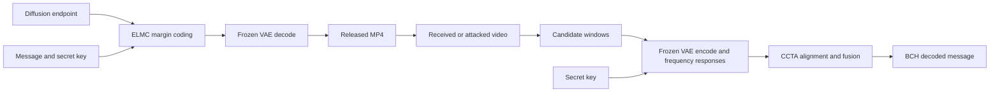

# LAST

Training-free, inversion-free video watermarking with endpoint latent-frequency margin coding (ELMC) and cross-group consistency temporal alignment (CCTA).

## Use LAST on one video

Try the [marked sailboat MP4](examples/public_demo/sailboat.mp4) (1.04 MB) with the [public demo commands](#read-the-sailboat-demo). This 65-frame example can be read with a VAE-only checkpoint.

Start with the [installation instructions](#install-linux-python310-cuda-capable-nvidia-gpu).

### Read the sailboat demo

For the reproducible sailboat example, run the following from the repository
root. It creates the exact public demonstration key, 64-byte padded message,
prompt and seed used for this Hunyuan T2V case. Anyone can derive this key.
For your own videos, generate a fresh key with `last.cli prepare-video`.

```bash
export LAST_DEMO_DIR="$HOME/last-sailboat-example"
python examples/public_demo/prepare.py --output "$LAST_DEMO_DIR"
```

To read an existing copy of the marked sailboat MP4, download just the
Hunyuan T2V VAE (986 MB). The example MP4 is included in this repository.
The following example scores the original and the random 30-frame deletion.
The output directory must be new. Run from the repository root.

```bash
export SAILBOAT_MP4=examples/public_demo/sailboat.mp4
export LAST_DEMO_VAE="$HOME/last-checkpoints/hunyuan_t2v"
python -m last.models --name hunyuan_t2v --directory "$LAST_DEMO_VAE" \
  --vae-only --download --verify-manifest configs/checkpoint_files.json
python -m last.check_video --video "$SAILBOAT_MP4" --video-id sailboat-demo-v1 --demo-codec-threads \
  --family hunyuan --model-dir "$LAST_DEMO_VAE" --key "$LAST_DEMO_DIR/secret.key" \
  --message "$LAST_DEMO_DIR/message.bin" --condition clean --condition drop \
  --output "$LAST_DEMO_DIR/clean-and-drop"
```

The demo flag fixes the H.264 encoder thread counts used to produce the
recorded MP4s. With automatic settings, the output bytes can depend on the
number of CPU cores available.

For all seven conditions, omit both `--condition` flags and choose a fresh
output directory. Compare your `summary.json` with the [verified demo results](results/public_sailboat_attacks.json).
Each row counts correctly recovered information bits in this one video.

| Condition | Received frames | Correct bits out of 512 |
|---|---:|---:|
| `clean` | 65 | 512 |
| `noise` | 65 | 512 |
| `compression` | 65 | 512 |
| `blur` | 65 | 512 |
| `drop` | 35 | 471 |
| `insert` | 95 | 408 |
| `clip` | 35 | 512 |

To display the decoded message from the original MP4, run:

```bash
python -m last.cli unpack-message --text \
  --prediction "$LAST_DEMO_DIR/clean-and-drop/clean-prediction.json" \
  --output "$LAST_DEMO_DIR/recovered.txt"
cat "$LAST_DEMO_DIR/recovered.txt"
```

The expected text is `LAST public reader demonstration v1`.

You can score a saved prediction later on CPU, even if the original payload
was unavailable during extraction. For the deletion example above:

```bash
python -m last.score_message --message "$LAST_DEMO_DIR/message.bin" \
  --prediction "$LAST_DEMO_DIR/clean-and-drop/drop-prediction.json" --show-errors
```

For the recorded deletion, this gives 471 correct bits and 41 wrong bit
positions. For the recorded insertion, it gives 408 correct bits and 104
wrong positions. Both predictions differ from the original message.


If you already have the pinned T2V checkpoint, point `LAST_DEMO_VAE` to
that directory and omit `--download` to verify it offline. The Wan-2.2
I2V and T2V manifests pin identical VAE files. The Hunyuan pair shares
the VAE weight digest, but its configurations record different Diffusers
versions. Select the matching mode for file verification.

To generate the sailboat video yourself, use `--family hunyuan --mode t2v`,
the full `hunyuan_t2v` checkpoint, and the prepared case, key and message
in the generation command below.

### Read your own marked MP4

If you already have a LAST-marked 512 × 512 MP4 and its 32-byte key, skip generation.
For a Hunyuan video, point `--model-dir` at the checkpoint directory containing
the matching `vae/` subdirectory. Extraction uses CUDA by default. For a CPU-only
run, add `--device cpu` to `last.extract` or `last.check_video`. CPU extraction
processes the same candidate windows and can take substantially longer.

```bash
python -m last.models --name hunyuan_i2v --directory /path/to/checkpoint \
  --vae-only --download --verify-manifest configs/checkpoint_files.json
```

This downloads the pinned VAE configuration and weights (986 MB for Hunyuan
I2V). Omit `--download` to verify an existing local copy offline. Generation
requires the full checkpoint.

For Wan-2.2 text-to-video, use `--name wan22_t2v` in the download command
and `--family wan22` in the extraction command below. Its VAE download is
508 MB. In the [offline Wan extraction check](results/wan22_t2v_vae_only_cli.json),
the reader recovered all 512 bits from one clean 65-frame MP4 using only
the key and the matching VAE. On the same sample after random deletion of 30 frames,
the [standalone reader](results/wan22_t2v_vae_only_cli_drop.json) recovered
329/512 bits from the remaining 35 frames, matching the archived evaluation. The
[seven-condition Wan example](results/wan22_t2v_single_video_attacks.json)
lists the frame counts, recovered bits and MP4 hashes. All six edits were rebuilt
with the standalone attack command using `--video-id paper-000 --map-seed 0`.

```bash
python -m last.extract --family hunyuan --model-dir /path/to/checkpoint \
  --video received.mp4 --key /private/secret.key --output /private/decoded.json
```

Both `last.extract` and `last.evaluate` default to a PyTorch allocator limit of
20% of total GPU memory. On a dedicated GPU, add `--memory-fraction 1` to
allow the reader to use available memory up to the device capacity.

Use a fresh output filename. The private JSON contains the recovered 512 bits
in `message_hex` and the error-correction outcome in `bch_success`. A payload
can still contain errors. To save the recovered 64 bytes from this prediction,
run the following on CPU. Choose a new output file in an existing directory.
For a message originally supplied with `prepare-video --text`, add `--text`
to remove trailing zero padding and save the UTF-8 text. A damaged message
can still be valid UTF-8.

```bash
python -m last.cli unpack-message --prediction /private/decoded.json --output /private/recovered.bin
```

If you know the original message, compare it with
the decoded bytes after extraction. The scoring command runs on CPU using
Python's standard library. It prints the correct-bit count, bit accuracy and
whether the entire message matches, without printing either message.

```bash
python -m last.score_message --message /private/message.bin --prediction /private/decoded.json
```

Add `--show-errors` to see which payload bits differ. Positions run from 0 to
511, with the most significant bit first in each byte. For example, changing
the first byte from hexadecimal `80` to `00` gives `wrong_bit_positions: [0]`,
511 correct bits and a failed whole-message match. Only this scoring step
reads the original payload.

### Generate and evaluate your own video

To **generate a marked video with your own message**, download and verify the
full Hunyuan I2V checkpoint. The pinned file inventory totals 43.65 GB
(decimal). If you already have the full checkpoint, omit `--download` for
an offline check. Run from the repository root:

```bash
python -m last.models --name hunyuan_i2v --directory /path/to/checkpoint \
  --download --verify-manifest configs/checkpoint_files.json
```

Choose a new directory outside the repository for the key, message and case.
Supply your prompt and image. The text identifier can contain up to 64 UTF-8
bytes and is padded with zeros. To supply an exact 512-bit payload, replace
`--text cyclist-example` with `--message-file /private/payload.bin`.

```bash
export LAST_EXAMPLE_DIR="$HOME/last-cyclist-example"
python -m last.cli prepare-video --output "$LAST_EXAMPLE_DIR" \
  --prompt "A cyclist rides along the path" --seed 42 \
  --image /path/to/your/cyclist.png --text cyclist-example
```

To mark multiple videos with your own key, add `--key-file /private/secret.key`
to each `prepare-video` command and choose a fresh output directory per video.
The file must contain exactly 32 bytes. Omitting this option generates a new key.

Select the checkpoint and pipeline together. For text-to-video, omit
`--image` from `prepare-video`; image-to-video requires a conditioning image.
Use the same family and checkpoint directory for generation and evaluation.

| Pipeline | Checkpoint name for `last.models` | Generation flags for `last.smoke` |
|---|---|---|
| Hunyuan image-to-video | `hunyuan_i2v` | `--family hunyuan --mode i2v` |
| Hunyuan text-to-video | `hunyuan_t2v` | `--family hunyuan --mode t2v` |
| Wan-2.2 image-to-video | `wan22_i2v` | `--family wan22 --mode i2v` |
| Wan-2.2 text-to-video | `wan22_t2v` | `--family wan22 --mode t2v` |

Run the following commands after replacing the paths with your own:

```bash
python -m last.smoke --family hunyuan --mode i2v --model-dir /path/to/checkpoint \
  --case "$LAST_EXAMPLE_DIR/case.json" --key "$LAST_EXAMPLE_DIR/secret.key" \
  --message "$LAST_EXAMPLE_DIR/message.bin" --output "$LAST_EXAMPLE_DIR/run" \
  --memory-gib 12 --offload sequential --marked-only
python -m last.evaluate --family hunyuan --model-dir /path/to/checkpoint \
  --run "$LAST_EXAMPLE_DIR/run" --video-id cyclist-example
```

For a shorter evaluation, append `--condition drop` to the second command to
test random frame deletion alone. To compare two edits that each leave 35 frames,
append `--condition drop --condition clip`. Both start from the same marked
MP4, and the evaluator loads the VAE at most once. To fill in the other conditions later, use the same run and
video ID and omit `--condition`. The evaluator verifies and reuses completed
receipts and their corresponding MP4 files.

The four examples below use the first frozen primary case (`paper-000`) in each pipeline. Each cell counts correct payload bits out of 512 after reading the received MP4. A count of 512 means the entire message matches. These four generations illustrate individual outcomes for one case.

| Condition | Edit | Received frames | [Hunyuan I2V](results/first_primary_sample.json) | [Hunyuan T2V](results/last_t2v_primary_first_case.json) | [Wan-2.2 I2V](results/last_wan_i2v_primary_first_case.json) | [Wan-2.2 T2V](results/wan22_t2v_single_video_attacks.json) |
|---|---|---:|---:|---:|---:|---:|
| `clean` | Read the original marked MP4 | 65 | 512 | 512 | 512 | 512 |
| `noise` | Add zero-mean Gaussian noise with standard deviation 0.05 to RGB values scaled to [0, 1], then clip and round to 8 bits | 65 | 512 | 512 | 512 | 512 |
| `compression` | Re-encode with H.264 at CRF 28 | 65 | 486 | 512 | 493 | 495 |
| `blur` | Apply a 5 × 5 Gaussian kernel with standard deviation 1 pixel | 65 | 512 | 512 | 512 | 512 |
| `drop` | Remove 30 uniformly sampled, distinct frame positions | 35 | 371 | 447 | 255 | 329 |
| `insert` | Insert 30 noise frames into randomly chosen positions, preserving the original frame order | 95 | 424 | 445 | 377 | 381 |
| `clip` | Remove a contiguous block of 30 frames with a uniformly sampled start | 35 | 502 | 500 | 487 | 495 |

All edits are read back from H.264 MP4 at 8 fps. Edited conditions other
than `compression` use CRF 18. The implementation draws each inserted RGB
channel value uniformly from 0 to 255. The default temporal map seed is 0;
use the same video ID and map seed across methods to reproduce the edit positions.

To score attacks on a standalone marked MP4 with a known 64-byte payload,
use the following command. It writes the received MP4, blind prediction
and a `summary.json` containing correct bits, total bits and whole-message
recovery. Only the scoring subprocess receives the original message.

```bash
python -m last.check_video --video received.mp4 --video-id cyclist-example \
  --family hunyuan --model-dir /path/to/checkpoint --key /private/secret.key \
  --message /private/message.bin --condition drop --output /private/drop-check
```

For blind extraction across attacks, omit `--message /private/message.bin`.
Each completed row links its prediction by filename. Bit accuracy and whole-message
recovery are available when you supply the original payload for scoring.

Omit `--condition drop` to run the original and all six edits. Each
condition runs in a separate reader process and reloads the VAE. Choose
a new output directory. A failed subprocess is recorded with its stage
and exit code while the remaining requested conditions continue.

If you have only a marked MP4, you can also create an attacked copy on CPU
without a key, checkpoint or generation run directory. For a 65-frame,
512 × 512 input, the following command writes a 35-frame output. Pass that
output as `--video` to the standalone extraction command above and compare
the decoded message with your original bytes if available.

For attack generation alone, the following dependencies suffice in a Linux
Python 3.10 environment. Run from the repository root:

```bash
python -m pip install numpy==1.26.4 pillow==11.0.0 opencv-python-headless==4.10.0.84 imageio-ffmpeg==0.6.0
export PYTHONPATH="$PWD/src"
```

```bash
python -m last.attack_video --video received.mp4 --video-id cyclist-example \
  --condition drop --output received-drop.mp4
```

The generation example above writes `$LAST_EXAMPLE_DIR/run/marked.mp4`
and checks the message after reloading the MP4. For paired PSNR and SSIM
measurements, omit `--marked-only` and use a fresh output directory to also
decode and export the unmarked reference. Both modes run diffusion once.
The evaluation command reuses the marked video for all requested conditions.
In a [single-video Hunyuan application check](results/hunyuan_i2v_marked_only_cli.json),
a separate extraction process recovered 512/512 bits from the clean MP4 and
348/512 after random deletion of 30 frames. The seven-condition evaluator on the same
video recovered the full message after noise and blur, 486/512 bits after
compression, 431/512 after insertion and 497/512 after contiguous removal.
All six edited MP4 files matched the outputs of the standalone CPU attack command.
See the per-condition JSON files in `$LAST_EXAMPLE_DIR/run/attacks/` for
`correct_bits`, `total_bits` and `exact_message` on completed reads.

View the [three-video LAST and LFG results](results/quickstart-three-videos.md)
for all seven conditions. To rebuild the table on CPU, run:

```bash
PYTHONPATH=src python tools/matched_primary_methods.py --family hunyuan --mode i2v \
  --methods last lfg --first 3 --reports results/hunyuan_i2v_primary24.json
```

Each cell shows correct bits out of 1,536 and complete messages out of three.
The preview reads existing measurements and requires all three videos for each condition.
For the LAST inputs, the [attack replay record](results/quickstart_three_attack_replay.json)
lists the frame count and SHA-256 for every MP4. In the pinned environment,
all 18 regenerated edits matched the archived files byte for byte. The three
clean entries refer to the original marked MP4s. All 21 hashes match the audited
observations used in the preview. The original per-attack receipts for these
samples omitted the MP4 digest.

## Reproduction status

For clean recovery and official quality results, see [HunyuanVideo](results/clean-quality/hunyuan.md) and [Wan-2.2](results/clean-quality/wan22.md). Each table lists dimension means and the number of applicable scoring units.

View the [measured attack results](results/primary-robustness/table.md) for all available pipelines and methods. Each cell gives the observed bit accuracy and the number of videos scored out of 400. The [underlying counts](results/primary-robustness/counts.csv) also give the number of messages recovered in full.

This repository is being constructed from a frozen manuscript protocol. Full-paper experiments have **not** been reproduced yet. Historical pilot results are not full-benchmark results, and manuscript values are not used as measured outputs.

The reproduction targets 512 information bits, two video backbones (HunyuanVideo and Wan-2.2 A14B), both T2V and I2V, matched baselines, spatial/temporal attacks, quality evaluation and ablations. Runs record model revisions, software versions, seed schedules, codec settings, raw counts, failures and hardware differences.

Generation uses an NVIDIA L40. The manuscript specifies an A800 for generation and an idle L40 for timing. The formal five-method timing table is awaiting exclusive measurements.

Secret keys, private messages, credentials and model weights are not committed.

## Method overview

LAST writes a BCH-coded message into selected middle-frequency coefficients of
the final diffusion latent. ELMC changes only coefficients that do not meet the
required signed margin along keyed orthogonal directions. Each temporal group
has its own codebook. The frozen VAE decodes the latent into the released video.

At extraction, candidate short windows are encoded directly by the frozen VAE.
CCTA combines keyed responses with temporal and cross-group message consistency,
then fuses evidence for BCH decoding. It does not run diffusion inversion or
require the original message, prompt, seed or unmarked video. This describes
the implemented mechanism, not a guarantee of recovery under every edit.



## Measured results

For main Tables 1 and 2, the [reporting guide](docs/REPORTING.md) gives the
clean and attacked table commands. The [paired temporal results](docs/REPORTING.md#matched-temporal-attacks-by-backbone-and-input-mode)
use matched LAST and LFG videos. The table below links the observations and
gives the sample count for each pipeline.
View the [component ablation table](results/table4-component-ablation.md), or run the following command from the repository
root to compare writer and reader variants on the same 14 of 30 planned
videos. It prints all seven conditions and the two writer fidelity scores.

```bash
python tools/matched_component_table.py --table4 --archived-reread results/hunyuan_i2v_archived_reader_four.json
```

The reader-only ablation covers 14 of those 30 videos. Run
`python tools/reader_ablation_table.py` to rebuild all 28 cells from the
archived counts. The [quality guide](docs/QUALITY.md#per-unit-last-and-reference-comparisons)
gives commands for comparing official quality scores by video or prompt.

**Primary random frame deletion remains a substantial reproduction discrepancy.**
The manuscript reports 96.0% bit accuracy and 368/400 exact messages for HunyuanVideo image-to-video after deleting 30 of 65 frames. The L40 rerun recovered **66,857/92,160 bits (72.54%) and 1/180 exact messages** across the first 180 videos. For 172 videos the original receipts identify the received MP4. The other eight use independent extractions from the archived videos because their original receipts lack that fingerprint. The two sets of video IDs are disjoint. Recount both contributions on CPU:

```bash
python tools/hunyuan_prefix_recovery.py --additional-original results/hunyuan_i2v_message_178_180.json \
  --verify-original-slice results/hunyuan_i2v_last_primary100_179.json
```

For deletion, the command reports 63,903/88,064 bits from original receipts and 2,954/4,096 bits from re-extraction. On the same 180 attacked videos, supplying the true frame map to the diagnostic reader yielded 91,068/92,160 correct bits (98.82%) and 104/180 complete messages. The assisted reader also fills missing slots and fuses surviving groups, so this comparison measures their combined effect. Even with this assistance, 76 messages still contained errors. Recount both readers on all seven conditions:

```bash
python tools/paired_oracle_table.py --report results/hunyuan_i2v_last_first100_robustness.json \
  --report results/hunyuan_i2v_last_primary100_179.json --manifest configs/primary_manifest.json \
  --oracle-dir results --count 180
```

A [controlled comparison with shared fusion](docs/ABLATIONS.md#shared-fusion-deletion-comparison)
holds the message fusion rule fixed on the first 179 Hunyuan I2V videos.
All three readers recovered every 512-bit message from the original videos.
After deleting 30 frames, grouping frames in received order recovered 47,507 of
91,648 bits (51.84%). Blind CCTA recovered 66,460 (72.52%). Neither reader
recovered a complete message after deletion. Supplying the true edit map
raised recovery to 90,564 bits (98.82%) and 104 complete messages out of 179.
Rebuild all three conditions from the per-video receipts:

```bash
python tools/controlled_reader_table.py results/hunyuan_i2v_last_controlled_paper*.json
```

To inspect the [170 original deletion records](results/hunyuan_i2v_primary_deletion_errors.json) separately:

```bash
python tools/primary_deletion_errors.py --report results/hunyuan_i2v_primary_deletion_errors.json
```

The [statistical protocol](docs/STATISTICS.md) also explains how to repeat the checks against the generated MP4 files. For supplementary margin sensitivity, the [five-strength comparison on 12 development videos](docs/ABLATIONS.md#paired-write-strength-sweep-on-twelve-development-videos) includes the Figure 4 curve and its CPU replay command. The 80-video sensitivity study and full quality scores are pending.

The following paired subsets use the frozen primary manifest and 512 information bits per video. Each method has seven observations per video, covering clean extraction and six attacks. The paper protocol calls for 400 videos per generation pipeline. The counts below describe the paired records available in this release.

| Generation pipeline | Paired videos | Bit counts by attack | Paired PSNR and SSIM |
|---|---:|---|---|
| HunyuanVideo, image-to-video | 45 | [First 40](results/hunyuan_i2v_primary40.json), [040–043](results/hunyuan_i2v_primary_040_043.json) and [paper-291](results/hunyuan_i2v_primary_slice291.json) | [First 40](results/hunyuan_i2v_fidelity40.json), [040–043](results/hunyuan_i2v_fidelity_040_043.json) and [paper-291](results/hunyuan_i2v_paired_fidelity_slice291.json) |
| HunyuanVideo, text-to-video | 15 | [First 14](results/hunyuan_t2v_primary14.json) and [paper-014](results/hunyuan_t2v_primary_slice014.json) | [First 14](results/hunyuan_t2v_fidelity14.json) and [paper-014](results/hunyuan_t2v_paired_fidelity_slice014.json) |
| Wan-2.2, image-to-video | 14 | [14 pairs](results/wan22_i2v_primary14.json) | [14 pairs](results/wan22_i2v_fidelity14.json) |
| Wan-2.2, text-to-video | 14 | [14 pairs](results/wan22_t2v_primary14.json) | [14 pairs](results/wan22_t2v_fidelity14.json) |

To sum the correct bits and count fully recovered messages for the 45 HunyuanVideo image-to-video pairs, run the command below. For another row, change the family, mode and input report. Each fidelity score uses the unmarked reference generated for that method. The [reporting notes](docs/REPORTING.md) document reference-file differences and sample coverage.

```bash
python tools/matched_primary_methods.py --family hunyuan --mode i2v --methods last lfg \
  --reports results/hunyuan_i2v_primary40.json results/hunyuan_i2v_primary_040_043.json results/hunyuan_i2v_primary_slice291.json
```

Earlier evidence includes the [four LAST integration checks](results/last_backbone_integrations.json), the [LFG adaptation check](results/lfg_integration.json), and the first formal cases for [LFG Hunyuan I2V](results/lfg_primary_first_case.json), [LAST Hunyuan T2V](results/last_t2v_primary_first_case.json), and [LAST Wan I2V](results/last_wan_i2v_primary_first_case.json).

## Install (Linux, Python3.10, CUDA-capable NVIDIA GPU)

```bash
git clone https://github.com/twzydn20000928/LAST.git
cd LAST
python3.10 -m venv .venv
source .venv/bin/activate
unset PYTHONPATH
export PYTHONNOUSERSITE=1
python -m pip install -r environments/video-linux-py310-cu124.txt
python -m pip install --no-deps -e .
python -m pip check
python -m last.doctor --strict --require-paper-runtime --output .venv/environment.json
python -m pytest -q
```

For extraction and attacks alone, a [smaller reader dependency set](environments/reader-linux-py310-cu124.txt)
is available for the same Linux platform. In the activated environment, run:

```bash
python -m pip install -r environments/reader-linux-py310-cu124.txt
python -m pip install --no-deps -e .
python -m pip check
```

This set was checked by isolating the 46 installed distributions, importing
the reader, decoding all 65 sailboat frames and encoding its first candidate
window at full resolution with the pinned Hunyuan VAE on CPU. The six CPU
attack commands reproduced all recorded demo MP4 hashes. A full MP4 extraction on CUDA with this smaller set is pending.
The video environment above supports generation and the test suite.

The numerical core implements masked1776-coordinate orthonormal DCT-II carriers, deterministic keyed QR, minimum signed margins, truth-free CCTA, an energy-spacing fallback and shortened BCH. It is distinct from earlier pilot implementations. See [the reproduction contract](docs/REPRODUCTION.md) and [frozen settings](configs/paper_v1.json).

## Fresh end-to-end smoke check

For the observed Linux/Python 3.10/CUDA 12.4 dependency versions, see
[environment reconstruction](environments/README.md). This includes transitive
dependencies and excludes server-specific overlay paths.

First follow [data preparation](docs/DATA.md) for the frozen400sample manifest
and verified conditioning images. See [release acceptance](docs/RELEASE_CHECKLIST.md)
for the complete paper-code deliverable and outstanding work.

Download a pinned checkpoint from `configs/models.json`. Supply a JSON case containing `prompt`, `seed` and, for I2V, a local `image` path. Keep output outside version control:

```bash
python -m last.models --name hunyuan_i2v --directory /path/to/checkpoint --download
python -m last.models --name hunyuan_i2v --directory /path/to/checkpoint \
  --verify-manifest configs/checkpoint_files.json
python -m last.models --name hunyuan_i2v --directory /path/to/checkpoint \
  --hash-output /private/model-hashes.json
python -m last.doctor --strict --output /private/environment.json
```

The offline verification command compares cached model files with the Git blob
and LFS digests from the pinned Hugging Face revision. Model cards, figures and
example assets are optional. The manifest covers all four model entries. Provider access
and model/data licenses remain applicable. Full checkpoint hashing can take time.

```bash
python -m last.smoke --family hunyuan --mode i2v \
  --model-dir /path/to/checkpoint --case /path/to/case.json \
  --output /private/runs/smoke-hunyuan-i2v --memory-gib 12 --offload sequential
```

For the validated formal Wan I2V execution, use `--family wan22 --mode i2v --memory-gib 8 --offload sequential` with the matching Wan checkpoint. The
earlier integration also supported model offload with a 42 GiB allocation;
record the chosen offload mode and memory limit with each run. The smoke run
generates a fresh secret/message, generates an unmarked endpoint, embeds LAST,
exports CRF18 MP4, rereads it and blindly extracts 512 information bits. It saves
an honest receipt and private key material. **A smoke run is not a 400-video
benchmark.** The generated keys/messages/predictions and videos must not be
committed.

Evaluate the seven primary attack conditions on that exported video:

```bash
python -m last.evaluate --family hunyuan --model-dir /path/to/checkpoint \
  --run /private/runs/smoke-hunyuan-i2v --video-id integration-case-0
```

Use the same `--video-id` across methods to share attack maps. Each condition
records a separate receipt; failed conditions remain failures, not zero accuracy.
See [implementation choices and reuse policy](docs/REUSE_AUDIT.md).

## Blind extraction of a received video

```bash
python -m last.extract --family hunyuan --model-dir /path/to/checkpoint \
  --video /path/to/received.mp4 --key /private/secret.key \
  --output /private/received.decoded.json
```

The reader rebuilds its codebook from a 32-byte key and encodes the received
512 × 512 RGB video with the frozen VAE. The private output's `message_hex`
field contains 64 decoded bytes (512 information bits, most significant bit
first). The command also records the frame count, alignment route and BCH
decoding status. Assessing accuracy requires a separate comparison to the
original message after extraction.

The [standalone integration check](results/blind_cli_integration.json) used
one Hunyuan I2V video. The clean 65-frame input recovered 512/512 true bits.
After deleting 30 frames, the 35-frame input recovered 371/512. On both
inputs a separately executed extraction returned the same 512 predicted bits,
including the same 141 incorrect bits on the deletion case. To check agreement
between two private outputs on your own MP4 without printing either message:

```bash
python tools/compare_blind_predictions.py --video received.mp4 --first first.decoded.json --second second.decoded.json
```

## Receipts, tables and paired fidelity

For the planned 400-sample LAST/LFG comparison, see [campaign commands](docs/CAMPAIGN.md).
The worker verifies the frozen source and sample manifest, supports disjoint shards
and resumes complete jobs. Other baselines and supplemental experiments remain
separate release requirements; a successful subset is not full-paper completion.

```bash
python -m last.report --plan configs/integration_plan.json \
  --root /private/runs/paper_reproduction_v1 --output /path/to/report
python -m last.quality --reference /private/run/reference.mp4 \
  --marked /private/run/marked.mp4 --output /private/run/quality.json
```

Reporting writes JSON, CSV and Markdown from an explicit list of planned runs.
Missing/failed observations stay visible; incomplete cells have no final score.
The bundled integration plan summarizes 35 observations from five video runs.
The example above reads stored counts. Three early generation receipts
(Hunyuan I2V LAST, Hunyuan T2V LAST and Wan I2V LAST) omit the method field,
so this historical set cannot pass full artifact verification. For new
benchmark runs, use the [artifact verification command](docs/REPORTING.md).
Paired fidelity reports global RGB-MSE PSNR and 11×11 Gaussian SSIM with the
precise metric definition and input hashes. Neither metric is official V-score
or proof of acceptable motion quality. No metric is filled using manuscript targets.

## Implementation and result status

Use the following entry points for the corresponding paper experiments. An
available command is not evidence that the full prescribed sample set has run.

| Experiment or prerequisite | Reader entry point | Current scope |
| --- | --- | --- |
| Primary and disjoint development data | [Data preparation](docs/DATA.md) | All 20 development conditioning images match decoded source frame zero and cover the 80 prescribed sample assignments. |
| Primary LAST/LFG generation and seven attacks | [Campaign](docs/CAMPAIGN.md), `last.smoke`, `last.evaluate` | Paired primary prefixes for both modes of both backbones; measured coverage appears above |
| SIGMark, VideoShield, VideoMark and LFG | [Baselines](docs/BASELINES.md) | [40 Hunyuan T2V VideoMark videos](results/hunyuan_t2v_videomark_first40.json) cover all seven conditions. Other native baselines have partial coverage; see the [condition counts](docs/REPORTING.md). |
| Paired PSNR/SSIM and official V-score | [Quality](docs/QUALITY.md), `last.quality`, `last.quality_report` | Hunyuan I2V LAST and its reference each have six of 18 dimensions, including both Creativity dimensions. Hunyuan T2V VideoMark has [two of 18](results/hunyuan_t2v_videomark_quality.json). Overall V-score pending. |
| Minimum-margin, CGC, sliding-window and CCTA ablations | [Ablations](docs/ABLATIONS.md), `last.reader_ablation`, `tools/writer_ablation_table.py` | 14/30 writer pairs and [14/30 reader cases](results/hunyuan_i2v_reader_ablation_14.json) cover all seven conditions. Table 4 includes all 14 cases after rerunning the four readers on the matching writer outputs for paper-270. |
| Margin sweep and uniform-profile control | [Figure 4 and Supplement Table 5](docs/ABLATIONS.md#completed-development-margin-sweep), [development-set sensitivity](docs/ABLATIONS.md#supplementary-development-set-margin-sensitivity) | All five margins for the three figure examples and for [10 of 80 development videos](results/development_margin_ten_videos.json). The three figure examples are included in the ten. Use `last.writer_replay --uniform-profile` for the separate profile control. |
| Matched-writer LFG-C, native LFG+CCTA and oracle grouping | [Paired reader command](docs/BASELINES.md#replay-the-seven-condition-reader-comparison), [oracle diagnostic](docs/ABLATIONS.md) | [18 Hunyuan I2V videos](results/hunyuan_i2v_lfg_ccta_first18.json) with seven paired reader comparisons each. Matched-fidelity calibration pending. |
| Supplement Table 12, shared-fusion reader comparison | [Run the readers and rebuild the table](docs/ABLATIONS.md#shared-fusion-per-case-workflow) | 110 Hunyuan I2V LAST videos. The [paired deletion analysis](docs/ABLATIONS.md#paired-deletion-differences-across-videos) covers the first 100. Received-order, CCTA and true-map readers share the same clean, deletion and compression inputs; calibrated energy is pending. |
| Supplement Table 15, temporal stress and repeated attack maps | [Rebuild counts and alignment diagnostics](docs/STRESS.md#recount-the-eight-edits-on-primary-videos) | 33 Hunyuan I2V videos with eight edits and five seeds each. Every edit covers 165 of 2,000 planned trials. |
| Bit errors, whole-message recovery and uncertainty | [Statistics](docs/STATISTICS.md), `last.message_outcomes`, `last.cluster_intervals` | Implemented; final summaries require complete planned observations |
| Main Table 3 and supplementary timing | [Acquire paired timings and build Table 3](docs/TIMING.md#main-table-3), [embedding time](docs/TIMING.md#direct-embedding-operation) | [Two exclusive L40 extraction measurements](results/hunyuan_i2v_last_extraction_timing.json) cover a separate LAST clip (paper-000). The frozen main-table clip is paper-291. The clean read passed BCH decoding; the deletion read failed. The full five-method comparison is pending. |
| Fresh environment and independent re-extraction | [Environment reconstruction](environments/README.md), [audit protocol](docs/STATISTICS.md), `last.reextract` | Separate seven-condition re-extraction checked; the reader's end-to-end clean-checkout verification is scheduled after repository construction |

Diagnostic JSON files under [results](results/) retain their sample scope and
provenance. They must not be pasted into full-benchmark table cells. The detailed
[release checklist](docs/RELEASE_CHECKLIST.md) remains the completion gate.

Additional experiment entry points are documented for [ablations](docs/ABLATIONS.md),
[temporal stress and repeated maps](docs/STRESS.md), and
[prompt-cluster uncertainty](docs/STATISTICS.md). Their availability is separate
from completion of the full experimental matrix.

Core tests are available. Fresh GPU integration checks are in progress. Dataset manifests, baseline adapters, complete attack runners, confidence intervals, supplemental controls and full-benchmark result bundles are release gates. No fabricated table or historical pilot value is shipped as a new measurement. Do not interpret this repository as a completed or independently validated reproduction.

## Citation and version identification

[CITATION.cff](CITATION.cff) describes the software repository under its existing
LAST contributors attribution. It is not a substitute for the manuscript author
list or a claim of conference acceptance. An archival paper identifier and named
paper authors are not supplied by the anonymous review manuscript, so none are
invented here. Cite the exact Git commit used, together with the frozen protocol
and environment files. For example:

```bibtex
@software{last_software,
  author = {{LAST contributors}},
  title = {{LAST}: Training-Free and Inversion-Free Watermarking for Video Diffusion with Cross-Group Temporal Alignment},
  url = {https://github.com/twzydn20000928/LAST},
  note = {Software under active reproduction; specify the exact commit used}
}
```

A successful integration test or CI run does not establish complete reproduction
of the manuscript tables; consult the release checklist and measured receipts.
